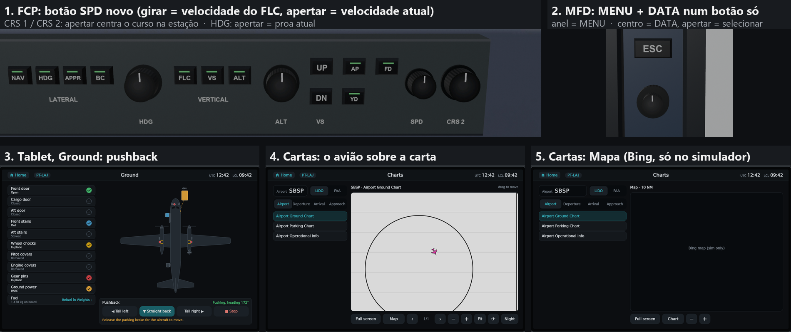
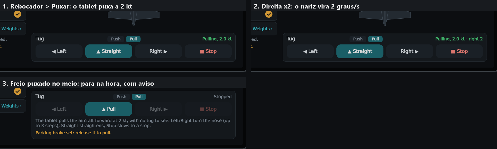

# Fokker F27 Mk500 — Modernized

**[Português](#português) · [English](#english)**



---

## Português

Add-on para o **Microsoft Flight Simulator 2024** que moderniza o **Fokker F27-500 v2 do bgaurant**. Ele traz aviônicos Working Title
WT21 (estilo Collins Pro Line, como no CJ4), o piloto automático e o FMS da Working Title, e um tablet próprio do F27. Ele aparece na
lista como um avião à parte ("Fokker F27500 Modernized …"). O F27 original continua intacto, e o cockpit original pode ser escolhido
no próprio tablet.

> **Download:** o pacote pronto para instalar está em
> [Releases](https://github.com/gustavosjp/Fokker-F27-MK500---Modernized/releases/latest) (`bgt-f27500-modernized-v11.0.zip`).
> É uma versão de testes: relatos de problemas são bem-vindos em *Issues*.

### Requisitos

- Microsoft Flight Simulator 2024.
- **O F27-500 v2 do bgaurant instalado** (pacote `bgt-f27500-v2`). O mod usa os modelos, texturas, sons e sistemas dele e não
  inclui nenhum arquivo dele.
- Opcional, só compilando a partir do código: as pinturas do Carlos Peroni (TAM PT-LAJ, Rio Sul PT-LZM e PT-LZN, SETE PS-SDW), para
  as variações Modernized dessas pinturas. Elas não vão na Release.
- Opcional: GSX Pro. Com o GSX ativo, o pushback do tablet passa pelo menu do GSX.

### Melhorias

**Cockpit Modernized e aviônicos**
1. PFD e MFD Working Title WT21 em retrato no lado do comandante, encaixados no painel original com moldura 3D.
2. Radioaltímetro, RMI e OAT originais numa coluna ao lado do PFD. Os relógios de motor e os instrumentos do copiloto originais
   continuam.
3. Faixa de motores dos Rolls-Royce Dart no MFD: torque, rpm, TGT, fluxo de combustível, pressão e temperatura do óleo. As cores
   seguem os limites do manual de manutenção do F27 (Dart RDa.7).
4. Painel de piloto automático estilo CJ4 (FCP) no glareshield:
   - teclas NAV, HDG, APPR, BC, FLC, VS, ALT, UP/DN, AP, FD e YD, com luzes de modo;
   - botões HDG, ALT, SPD, CRS 1 e CRS 2. Apertar o HDG sincroniza na proa atual, o CRS aponta direto para a estação, e o SPD pega a
     velocidade atual. O SPD gira a velocidade do FLC.
5. Painel de controle das telas (DCP) com botões duplos MENU/DATA, RANGE/TILT e BARO.
6. Teclas na moldura do MFD e botão duplo MENU/DATA. Apertar o centro seleciona a opção.
7. CDU do FMS no pedestal, com teclado completo (67 teclas).
8. Hardware 3D no estilo do CJ4: teclas que afundam ao clicar, botões que giram e barras de luz nas teclas ativas.
9. Interruptores dos servos do piloto automático (DIR, ROULIS, PROF, TRIM) num painel próprio, onde ficava o piloto automático antigo.
10. Piloto automático e FMS da Working Title voando o F27. A lógica do piloto automático TAPIR original fica desligada nessa variação.
11. Yaw damper funcionando e diretor de voo (FD).
12. Aviônicos ligados ao circuito de instrumentos do avião: apagados com o avião frio e escuro.

**Cockpit Classic**

13. Troca entre os cockpits Modernized e Classic (o original do autor) no próprio tablet, em Ajustes.
14. No Classic, o painel TAPIR original comanda o piloto automático da Working Title: HDG, VOR/LOC/APP, ALT, IAS (FLC) e PITCH.

**Tablet do F27**

15. Tablet 3D num braço que dobra contra a parede (clique na moldura).
16. Tela inicial com apps, hora UTC e local, português ou inglês, kg ou lb, brilho.
17. **Voo:** importação do OFP do SimBrief e envio da rota ao FMS.
18. **Cartas:**
    - cartas LIDO e FAA do próprio simulador (aeroporto, saídas, chegadas, aproximações), com zoom, arrastar, modo noturno e tela
      cheia;
    - o avião desenhado sobre as cartas georreferenciadas;
    - mapa móvel (Bing) com a rota do OFP.
19. METAR do aeroporto mais próximo, de origem, de destino ou de alternativa.
20. Checklist interativo do F27 e limitações do avião e dos motores Dart.
21. **Solo:** portas, escadas, GPU, calços, capas de pitot e de motor e pinos do trem, com uma vista de cima do avião.
22. **Rebocador:**
    - empurrar com o rebocador do simulador, ou, com o GSX ativo, pelo menu do GSX, com o andamento mostrado no tablet;
    - puxar para a frente: o próprio tablet move o avião a 2 kt, com curva para os dois lados.
23. **Pesos e balanceamento:**
    - cabine de 52 lugares, porões e combustível;
    - CG em %MAC e limites (MZFW, MTOW, MLW);
    - embarque, desembarque e abastecimento em ritmo real ou instantâneo;
    - plano carregado do SimBrief.
24. **Sistemas:** sinópticos de motores, combustível, elétrico, ar e pneumático.

**Exterior e solo**

25. Calços de borracha nas rodas principais. As escadas acompanham os calços.
26. Capas de pitot e dos motores, e pinos do trem com fitas REMOVE BEFORE FLIGHT.

**Pinturas e pacote**

27. Variações Modernized para as pinturas do Carlos Peroni: TAM PT-LAJ, Rio Sul PT-LZM e PT-LZN, SETE PS-SDW. São geradas ao
    compilar a partir do código, com os pacotes dele instalados; não vão na Release.
28. Pacote add-on separado (`bgt-f27500-modernized`) que herda o avião do autor, como fazem as pinturas. Não altera o F27 original.



### Instalação

1. Instale o F27-500 v2 do bgaurant.
2. Baixe o `bgt-f27500-modernized-v11.0.zip` em
   [Releases](https://github.com/gustavosjp/Fokker-F27-MK500---Modernized/releases/latest) e extraia a pasta
   `bgt-f27500-modernized` dentro da pasta Community do MSFS 2024.
3. No simulador, escolha "Fokker F27500 Modernized it80" na lista de aviões.

### Compilar a partir do código

São necessários o Windows, o MSFS 2024 e o SDK dele (fspackagetool), Node.js e Python 3 com Pillow e numpy. Também é preciso uma
cópia do avião do autor e o [msfs-avionics-mirror](https://github.com/microsoft/msfs-avionics-mirror), de onde o WT21 é compilado.
Os scripts usam os caminhos da máquina de desenvolvimento (`C:\Projetos\…`), definidos no início de cada script.

```powershell
cd plugin-wt21; npm install; npm run build; cd ..
.\tools\build-wt21.ps1
.\scaffold.ps1 -Force -NoLiveries
.\verify-package.ps1 -Source
node tools\make-addon.mjs PackageSources\bgt-f27500-modernized C:\Projetos\bgt-f27500-v2 addon-report.json
node tools\verify-addon.mjs PackageSources\bgt-f27500-modernized C:\Projetos\bgt-f27500-v2 "$env:LOCALAPPDATA\Packages\Microsoft.Limitless_8wekyb3d8bbwe\LocalCache\Packages\Community"
.\build-package.ps1        # com o simulador fechado
.\deploy-community.ps1
```

O diário técnico completo de cada versão, em inglês, está em [docs/DEVELOPMENT.md](docs/DEVELOPMENT.md).

### Arquivos derivados do avião do autor

O pacote não inclui nenhum arquivo original do bgaurant: modelos, texturas, sons e sistemas vêm do pacote dele. Alguns arquivos são
gerados a partir dos dele e vão no pacote com a autorização dele:

- **WASM de sistemas:** cópia do módulo dele com os eventos de modo e de servo do piloto automático TAPIR e a regra GPU→escadas
  desligados.
- **Modelos:** o JSON dos modelos 3D (a cena dele com as nossas peças) e o XML do exterior. A geometria continua lida do pacote dele.
- **Configurações:** `panel.cfg` (os instrumentos dele mais os nossos), `model.CFG` e `systems.cfg` (o ganho do yaw damper vai a 1,0).

### Créditos e licenças

- **Fokker F27-500 v2:** bgaurant. Não está incluído e é obrigatório.
- **Aviônicos WT21, SDK do MSFS e wtlinesdk:** Working Title / Microsoft
  ([msfs-avionics-mirror](https://github.com/microsoft/msfs-avionics-mirror)). Licença MIT com o adendo "uso somente no Microsoft
  Flight Simulator" ([licenses/WorkingTitle-Microsoft-LICENSE.txt](licenses/WorkingTitle-Microsoft-LICENSE.txt)). Usados sem
  alteração no código; só a pasta foi renomeada (`WT21v2` → `F27WT21`), e o MFD recebe o nosso plugin pela API de plugins do WT21.
- **Pinturas e texturas 4K:** Carlos Peroni. Não estão incluídas.
- **GSX Pro:** FSDreamTeam. Não está incluído; a integração usa as variáveis documentadas do GSX.
- **Fonte DejaVu Sans:** [licenses/DejaVu-LICENSE.txt](licenses/DejaVu-LICENSE.txt).
- **Código deste repositório:** licença MIT ([LICENSE](LICENSE)). Os componentes de terceiros mantêm as licenças deles
  ([THIRD_PARTY_NOTICES.md](THIRD_PARTY_NOTICES.md)).

Este projeto não tem vínculo com a Fokker, com o bgaurant, com a Working Title/Microsoft nem com a FSDreamTeam.

---

## English

An add-on for **Microsoft Flight Simulator 2024** that modernizes **bgaurant's Fokker F27-500 v2**. It brings Working Title WT21
avionics (Collins Pro Line style, as in the CJ4), the Working Title autopilot and FMS, and an F27 tablet of its own. It shows up in
the aircraft list as a separate aircraft ("Fokker F27500 Modernized …"). The original F27 stays untouched, and the original cockpit
can be picked from the tablet itself.

> **Download:** the ready-to-install package is in
> [Releases](https://github.com/gustavosjp/Fokker-F27-MK500---Modernized/releases/latest) (`bgt-f27500-modernized-v11.0.zip`).
> It is a test version: bug reports are welcome in *Issues*.

### Requirements

- Microsoft Flight Simulator 2024.
- **bgaurant's F27-500 v2 installed** (package `bgt-f27500-v2`). The mod uses his models, textures, sounds and systems and includes
  none of his files.
- Optional, only when building from source: Carlos Peroni's liveries (TAM PT-LAJ, Rio Sul PT-LZM and PT-LZN, SETE PS-SDW), for their
  Modernized variations. They are not in the Release.
- Optional: GSX Pro. With GSX running, the tablet's pushback goes through the GSX menu.

### Improvements

**Modernized cockpit and avionics**
1. Working Title WT21 PFD and MFD in portrait on the captain's side, fitted to the original panel with a 3D bezel.
2. The original radio altimeter, RMI and OAT in a column beside the PFD. The original engine gauges and copilot instruments stay.
3. Rolls-Royce Dart engine band on the MFD: torque, rpm, TGT, fuel flow, oil pressure and temperature. The colours follow the limits
   of the F27 maintenance manual (Dart RDa.7).
4. CJ4-style autopilot panel (FCP) on the glareshield:
   - NAV, HDG, APPR, BC, FLC, VS, ALT, UP/DN, AP, FD and YD keys with mode lights;
   - HDG, ALT, SPD, CRS 1 and CRS 2 knobs. Pushing HDG syncs to the current heading, CRS points straight to the station, and SPD takes
     the current speed. SPD turns the FLC speed.
5. Display control panel (DCP) with MENU/DATA, RANGE/TILT and BARO dual knobs.
6. MFD bezel keys and a MENU/DATA dual knob. Pushing the centre selects.
7. FMS CDU on the pedestal with a full keypad (67 keys).
8. CJ4-style 3D hardware: keys that sink when clicked, knobs that turn, light bars on active keys.
9. The autopilot servo switches (DIR, ROULIS, PROF, TRIM) on a panel of their own, where the old autopilot was.
10. The Working Title autopilot and FMS fly the F27. The original TAPIR autopilot logic is turned off in this variation.
11. Working yaw damper and flight director (FD).
12. Avionics on the aircraft's instrument circuit: dark when the aircraft is cold and dark.

**Classic cockpit**

13. Switch between the Modernized and Classic (the author's original) cockpits on the tablet itself, in Settings.
14. In Classic, the original TAPIR panel drives the Working Title autopilot: HDG, VOR/LOC/APP, ALT, IAS (FLC) and PITCH.

**F27 tablet**

15. A 3D tablet on an arm that folds against the side wall (click the bezel).
16. Home screen with apps, UTC and local time, Portuguese or English, kg or lb, brightness.
17. **Flight:** SimBrief OFP import and route upload to the FMS.
18. **Charts:**
    - the simulator's own LIDO and FAA charts (airport, departures, arrivals, approaches), with zoom, drag, night mode and full
      screen;
    - the aircraft drawn on georeferenced charts;
    - a moving map (Bing) with the OFP route.
19. METAR for the nearest, origin, destination or alternate airport.
20. Interactive F27 checklist, and the limitations of the aircraft and the Dart engines.
21. **Ground:** doors, stairs, GPU, chocks, pitot and engine covers and gear pins, with a top view of the aircraft.
22. **Tug:**
    - push back with the simulator's tug, or, with GSX running, through the GSX menu, with its progress on the tablet;
    - pull forward: the tablet itself moves the aircraft at 2 kt and can turn it either way.
23. **Weight and balance:**
    - 52-seat cabin, holds and fuel;
    - CG in %MAC and the limits (MZFW, MTOW, MLW);
    - boarding, deboarding and refuelling at real pace or at once;
    - plan loaded from SimBrief.
24. **Systems:** engine, fuel, electrical, air and pneumatic synoptics.

**Exterior and ground**

25. Rubber chocks at the main wheels. The stairs follow the chocks.
26. Pitot and engine covers, and gear pins with REMOVE BEFORE FLIGHT streamers.

**Liveries and package**

27. Modernized variations for Carlos Peroni's liveries: TAM PT-LAJ, Rio Sul PT-LZM and PT-LZN, SETE PS-SDW. They are generated
    when building from source with his packages installed; they are not in the Release.
28. A separate add-on package (`bgt-f27500-modernized`) that inherits the author's aircraft, as liveries do. It does not change the
    original F27.

### Installation

1. Install bgaurant's F27-500 v2.
2. Download `bgt-f27500-modernized-v11.0.zip` from
   [Releases](https://github.com/gustavosjp/Fokker-F27-MK500---Modernized/releases/latest) and extract the
   `bgt-f27500-modernized` folder into the MSFS 2024 Community folder.
3. In the simulator, pick "Fokker F27500 Modernized it80" in the aircraft list.

### Building from source

You need Windows, MSFS 2024 and its SDK (fspackagetool), Node.js, and Python 3 with Pillow and numpy. You also need a copy of the
author's aircraft and the [msfs-avionics-mirror](https://github.com/microsoft/msfs-avionics-mirror), which WT21 is built from. The
scripts use the development machine's paths (`C:\Projetos\…`), set at the top of each script.

```powershell
cd plugin-wt21; npm install; npm run build; cd ..
.\tools\build-wt21.ps1
.\scaffold.ps1 -Force -NoLiveries
.\verify-package.ps1 -Source
node tools\make-addon.mjs PackageSources\bgt-f27500-modernized C:\Projetos\bgt-f27500-v2 addon-report.json
node tools\verify-addon.mjs PackageSources\bgt-f27500-modernized C:\Projetos\bgt-f27500-v2 "$env:LOCALAPPDATA\Packages\Microsoft.Limitless_8wekyb3d8bbwe\LocalCache\Packages\Community"
.\build-package.ps1        # with the simulator closed
.\deploy-community.ps1
```

The full engineering log of every version is in [docs/DEVELOPMENT.md](docs/DEVELOPMENT.md).

### Files derived from the author's aircraft

The package includes none of bgaurant's original files: models, textures, sounds and systems come from his package. Some files are
generated from his and ship with his permission:

- **Systems WASM:** a copy of his module with the TAPIR autopilot mode and servo events and the GPU→stairs rule turned off.
- **Models:** the JSON of the 3D models (his scene with our parts) and the exterior XML. The geometry is still read from his package.
- **Configuration:** `panel.cfg` (his instruments plus ours), `model.CFG` and `systems.cfg` (yaw damper gain set to 1.0).

### Credits and licenses

- **Fokker F27-500 v2:** bgaurant. Not included, and required.
- **WT21 avionics, MSFS SDK and wtlinesdk:** Working Title / Microsoft
  ([msfs-avionics-mirror](https://github.com/microsoft/msfs-avionics-mirror)). MIT license with the addendum "only for usage in
  Microsoft Flight Simulator" ([licenses/WorkingTitle-Microsoft-LICENSE.txt](licenses/WorkingTitle-Microsoft-LICENSE.txt)). Used
  with no change to their code; only the folder is renamed (`WT21v2` → `F27WT21`), and the MFD gets our plugin through the WT21
  plugin API.
- **Liveries and 4K textures:** Carlos Peroni. Not included.
- **GSX Pro:** FSDreamTeam. Not included; the integration uses GSX's documented variables.
- **DejaVu Sans font:** [licenses/DejaVu-LICENSE.txt](licenses/DejaVu-LICENSE.txt).
- **This repository's code:** MIT license ([LICENSE](LICENSE)). Third-party components keep their own licenses
  ([THIRD_PARTY_NOTICES.md](THIRD_PARTY_NOTICES.md)).

This project is not affiliated with Fokker, bgaurant, Working Title/Microsoft or FSDreamTeam.
